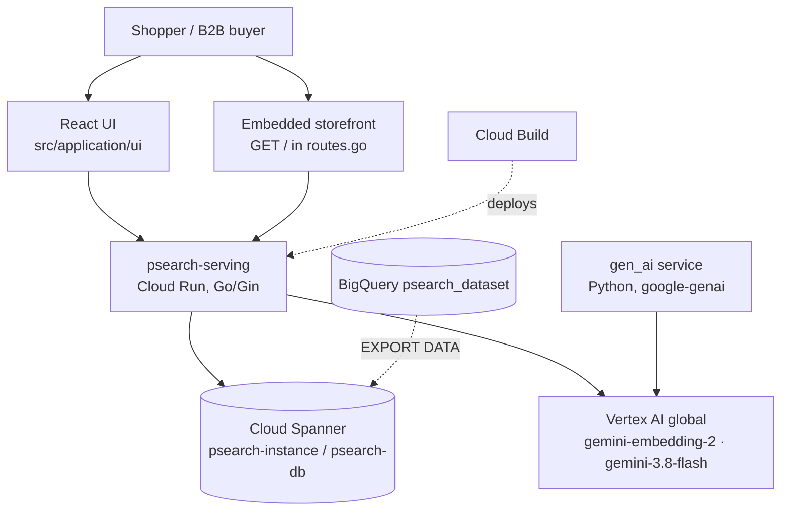
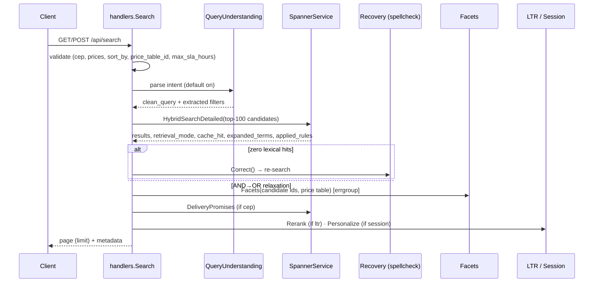

# PSearch — Architecture & Technical Design

**Code:** `src/psearch/serving` (Go 1.26, Gin) · **Requirements:** [PRODUCT.md](PRODUCT.md) · **Deployment:** [DEPLOYMENT.md](DEPLOYMENT.md)

---

## 1. System context



The serving binary (`cmd/server/main.go`) owns every request path. Spanner is the system of record for catalog, vectors, rules, synonyms, inventory, prices, suggestions, sessions and caches. Vertex AI is called only for query embeddings (v2) and, optionally, for the conversational-intent fallback.

### Code map

| Concern | File(s) |
|---|---|
| Routing, embedded storefront | `internal/api/routes.go` |
| Request handling, orchestration | `internal/api/handlers.go` (`Search`, `Autocomplete`, rules/synonyms/session/config endpoints) |
| Request/response models | `internal/models/models.go` |
| Configuration (env) | `internal/config/config.go` |
| Hybrid retrieval SQL, memory engine | `internal/services/spanner_service.go` (`HybridSearchDetailed`, `buildHybridSQLWith`, `catalogFilterSQL`) |
| Embeddings + cache | `internal/services/embedding_service.go`, `embedding_cache.go` |
| Accent folding | `internal/services/textfold.go` (`FoldAccents`) |
| Facets | `internal/services/facets.go` |
| Synonyms | `internal/services/synonyms.go` |
| Merchandising + boost signals | `internal/services/merchandising.go` |
| Delivery promises | `internal/services/delivery.go` |
| Autocomplete | `internal/services/autocomplete.go` |
| Learning to Rank | `internal/services/ltr.go` |
| Query understanding | `internal/services/query_understanding.go` |
| Spell check / relaxation | `internal/services/spellcheck.go` |
| Session personalization | `internal/services/session.go` |
| B2B pricing | `internal/services/pricing.go` |
| Pre-deploy SQL gate | `cmd/sqlcheck/main.go` |
| v2 embedding backfill | `cmd/backfill-embeddings/main.go` |

---

## 2. Search request pipeline



1. **Validation** (400 on bad `cep`, `min_price`/`max_price`, `max_sla_hours` outside 0–1440, `price_table_id`, `sort_by`). `alpha` is clamped to [0, 1].
2. **Query understanding** decomposes the query unless `parse_intent=false`.
3. **Stage 1 retrieval** fetches up to `max(limit, 100)` candidates so facets see a wider set than the page.
4. **Zero-results recovery** runs only when no candidate has a text score.
5. **Facets**, **delivery promises**, **LTR** and **session personalization** are applied to the candidates; the page is truncated to `limit` last.

---

## 3. Hybrid retrieval in Spanner

`buildHybridSQLWith(column, lexicalOnly, folded)` renders one statement with two CTEs and an RRF fusion:

```sql
@{OPTIMIZER_VERSION=latest_version}
WITH ann AS (  -- vector leg: ORDER BY COSINE_DISTANCE(<embedding|embedding_v2>, @query_embedding)
       ... WHERE <col> IS NOT NULL AND <catalogFilterSQL> ...),
     fts AS (  -- text leg: SEARCH(title/description tokens, @query_text) OR SEARCH(..., @syn_text)
       ... ORDER BY exact_first, SCORE(@query_text) + @syn_weight * SCORE(@syn_text) DESC)
SELECT rrf_score, vector_score, text_score, ..., boost_score, rule_mult, effective_price
FROM (SELECT a.*, @boost_weight * <8-signal score> AS boost_score,
             EXP(SUM(LN(r.multiplier))) over matching @rule_boosts AS rule_mult,
             pin_rank, buried, <effective price>
      FROM (SELECT SUM(weight / (60 + rank)) AS rrf_score, ... GROUP BY product_id) a
      JOIN products p ON p.product_id = a.product_id)
ORDER BY unavailable_rank, pin_rank, buried,
         <price sort if sort_by>, rrf_score * rule_mult + boost_score DESC,
         vector_score DESC, text_score DESC, product_id
LIMIT @limit
```

- **RRF:** `rrf = α · 1/(60 + rank_vector) + (1 − α) · 1/(60 + rank_text)`; the vector leg weight is `@alpha`, the text leg `1 − @alpha`.
- **`catalogFilterSQL`** (applied inside **both** legs): visibility, channel, only-available, `tenant_id`, `locale`, `category`, `brand`, effective-price `min_price`/`max_price`, B2B exclusive assortment, and the CEP/SLA `EXISTS` over `regional_inventory`. All values are bound parameters; only package constants (column names, token lists) are interpolated.
- **Accent folding:** with `TEXT_FOLDING=true` the text leg searches `title_tokens_folded` / `description_tokens_folded` (generated `TOKENIZE_FULLTEXT(REGEXP_REPLACE(NORMALIZE(x, NFD), r'\p{M}', ''))`, migration 014b) and the query is folded in Go.
- **Optimizer hint:** the correlated `product_prices` lookups change the plan so that `SCORE()` needs optimizer version ≥ 6; the statement hint `@{OPTIMIZER_VERSION=latest_version}` is set on the hybrid query.
- **Retrieval modes:** `hybrid_v1`, `hybrid_v2`, `lexical_only_degraded` (v2 active but no query embedding), `memory_fallback` (no Spanner client or a SQL error). A successful empty Spanner result is authoritative and is returned as-is.
- **Memory engine:** `memoryHybridSearchExpanded` mirrors every rule above over `DefaultSeedProducts()` with deterministic 768-d embeddings, so the full suite runs offline (`go test -race ./...`).

### Scoring

| Term | Definition |
|---|---|
| `boost` | `BOOST_WEIGHT · Σ wᵢ · normᵢ` over 8 signals (weights 0.15/0.20/0.10/0.15/0.10/0.10/0.10/0.10; `clicks/(clicks+100)`, `orders/(orders+20)`, percentages /100, others clamped to [0,1]) |
| `rule_multiplier` | product of matching rule multipliers (clamped to [0.1, 10]) |
| `final_score` | `rrf · rule_multiplier + boost` |

---

## 4. Vectors and embedding cache

- `EmbeddingService` uses `google.golang.org/genai` (Vertex backend, `GENAI_LOCATION=global`) with `Models.EmbedContent`, task type `RETRIEVAL_QUERY`, `OutputDimensionality = EMBEDDING_DIMENSION` (1024). Responses with the wrong dimension are rejected.
- `EmbeddingCache`: key = SHA-256(normalized text ‖ model ‖ dims); tier 1 = LRU (1000), tier 2 = Spanner `embedding_cache`; store reads have a 200 ms budget (1.5 s until the first successful read on a cold instance); writes are asynchronous and best-effort.
- Blue/Green: `ACTIVE_EMBEDDING_VERSION=v1` → `embedding` (768-d legacy), `v2` → `embedding_v2` (1024-d). `cmd/backfill-embeddings` fills v2 with `RETRIEVAL_DOCUMENT` vectors.

## 5. Facets

`Facets(ids, priceTable, tenant)` runs four `SELECT <expr> AS value, COUNT(*) … WHERE product_id IN UNNEST(@ids) GROUP BY value` queries concurrently with `errgroup`. The price bucket uses the effective (contract) price.

## 6. Synonyms

`SynonymService.Expand` normalizes and folds the query, matches whole phrase and tokens against `search_synonyms` for the tenant/locale (TTL cache 1 min) and returns terms rendered as `"a" OR "b c"`. In SQL the text leg orders exact matches first and adds `@syn_weight · SCORE(@syn_text)`.

## 7. Merchandising

`RuleService.Match` merges active tenant rules whose folded `query_pattern` is a substring of the query (empty = all queries) into boosts (passed as `ARRAY<STRUCT<brand, category, multiplier>>`), pins (ordered) and buries.

## 8. Delivery promises

`skus` is interleaved in `products`, `regional_inventory` in `skus`. `NormalizeCEP` produces a 5-digit prefix compared lexically with `zip_prefix_start/end`. `DeliveryPromises` returns the fastest in-stock row per product (`ORDER BY sla_hours, shipping_cost`); free shipping reports cost 0. Labels: ≤24 h "Chega amanhã", ≤48 h "Chega em 2 dias", otherwise "Chega em até N dias".

## 9. Autocomplete

`autocomplete_suggestions` stores `suggestion_folded` (plain column; Spanner rejects expressions inside `TOKENIZE_NGRAMS`) and `suggestion_ngrams = TOKENIZE_NGRAMS(suggestion_folded, 2, 4)` with search index `autocomplete_ngram_idx`. Queries use `SEARCH_NGRAMS` as the only search predicate (it cannot be OR-ed with unindexed predicates) and order by `STARTS_WITH` prefix-first, `ctr_score`, `search_count`. One-character prefixes use a `STARTS_WITH` query.

## 10. Learning to Rank

Features (normalized to [0,1]): `rrf_score`, `vector_score`, `text_score` (min-max within candidates), the 8 boost signals, and `sla_hours` (1 = next day, 0 = ≥7 days, 0.5 unknown). Model: `bias + Σ wᵢxᵢ + Σ stumps`. `Rerank` keeps availability, pins and buries in precedence and records `stage1_rank`, `stage2_rank`, `ltr_score`. Price sorts skip LTR. Tested < 2 ms for 100 candidates (observed 20–50 µs).

## 11. Query understanding

Deterministic parser: price regexes (`até/under/hasta …`, `acima de/over/desde …`, `entre X e Y`), number formats (`1.500,00`, `1,299.90`), catalog brand/category vocabulary (`CatalogVocabulary`), color lexicon (pt/en/es → canonical, kept in `clean_query` because the catalog has no color column). Brands are removed from `clean_query` and become filters; categories stay in the text. Gemini fallback (`GEMINI_TEXT_MODEL`, default `gemini-3.8-flash`) is used only when the parser finds nothing and the query has ≥ 4 tokens, behind `INTENT_LLM_FALLBACK`; output is sanitized and cached (LRU + `query_intent_cache`).

## 12. Zero-results recovery

`SpellCheckService` vocabulary = catalog titles/brands/categories + suggestions + synonyms; Spanner `SEARCH_NGRAMS` over `autocomplete_ngram_idx` adds candidates. Optimal-string-alignment distance ≤ 2 (≤ 1 for tokens ≤ 4 chars, distance 2 needs ≥ 6 chars), popularity tie-break, ambiguity guard; known words and numeric tokens are never changed. A correction is accepted when the re-search has text hits, or when re-parsing the corrected query yields a brand/category entity that returns results (e.g. brand "samsung"). Otherwise `RelaxedQuery` turns implicit AND into `t1 OR t2`.

## 13. Session personalization

```
centroid = normalize( Σᵢ wᵢ · v(productᵢ) ),  wᵢ = (3 if purchase else 1) · 0.85^i   (i = 0 newest, last 20 events)
session_boost(p) = SESSION_BOOST_WEIGHT · max(0, cos(centroid, v(p)))          (default weight 0.003)
personalized_score = (ltr_score if LTR ran else final_score) + session_boost
```

Vectors come from the active embedding column (`ProductVectors`) or the deterministic memory vectors. Re-sorting keeps availability, pins, buries and an explicit price sort ahead of the personalized score.

## 14. B2B pricing

`effective_price = COALESCE((SELECT pp.price FROM product_prices pp WHERE pp.product_id = p.product_id AND pp.price_table_id = @price_table AND pp.tenant_id = @tenant_id), p.price)`. Exclusive rows (`is_exclusive`) hide a product unless the buyer is on one of its tables. `applyEffectivePrice` sets `priceInfo.numericPrice` to the effective price and keeps `basePrice` / `originalPrice` as the list price.

---

## 15. API reference

Base URL: the Cloud Run service URL (`<SERVICE_URL>`) or `http://localhost:8080`. Admin writes require header `X-Admin-Token` equal to `ADMIN_TOKEN` (constant-time comparison); they return 403 when the header is wrong or `ADMIN_TOKEN` is unset.

| Method | Path | Auth | Purpose |
|---|---|---|---|
| GET | `/health`, `/healthz`, `/api/health` | public | Liveness (`status`, `backend_mode`) |
| GET | `/api/info` | public | Models, embedding version/dimension, cache stats, product count |
| GET / POST | `/api/config/embedding-version` | public / admin | Read / switch active embedding version (per instance) |
| GET / POST | `/api/synonyms` | public / admin | List / upsert tenant-locale synonyms |
| GET | `/api/autocomplete` | public | Typeahead (`q`, `locale`, `tenant_id`, `limit` ≤ 20) |
| POST / GET | `/api/session/events` | public | Record / list session events |
| GET | `/api/rules` | public | List merchandising rules (`tenant_id`) |
| POST · PUT `/:id` · DELETE `/:id` | `/api/rules` | admin | Create / replace / delete rules |
| GET / POST | `/api/search`, `/search` | public | Search |
| GET | `/` | public | Embedded storefront (or static React build when `STATIC_DIR` exists) |

### `/api/search` parameters (GET name = POST JSON name unless noted)

| Parameter | Type | Default | Notes |
|---|---|---|---|
| `q` (GET; also `query`) / `query` (POST) | string | "" | |
| `limit` | int | `DEFAULT_LIMIT` (20) | ≤ 0 → default |
| `min_score` | float | `MIN_SCORE_VALUE` (0) | POST only |
| `alpha` | float | `DEFAULT_HYBRID_ALPHA` (0.5) | clamped to [0,1] |
| `category`, `brand` | string | "" | case-insensitive exact match |
| `only_in_stock` | bool | false | |
| `channel` | string | "" | `web`, `mobile`, `store` |
| `tenant_id` | string | `default` | |
| `locale` | string | "" (all) | `pt-BR`, `en-US`, `es-MX` |
| `cep` | string | "" | 8 digits, else 400 |
| `max_sla_hours` | int | 0 (any) | 0–1440, else 400 |
| `ltr` | bool | false | skipped for price sorts |
| `parse_intent` | bool | true | `false` disables query understanding |
| `min_price`, `max_price` | float | 0 (none) | ≥ 0 and min ≤ max, else 400 |
| `price_table_id` | string | "" (list price) | `^[a-z0-9][a-z0-9-]{0,63}$`, else 400 |
| `sort_by` | string | relevance | `relevance`, `price_asc`, `price_desc`, else 400 |
| `session_id` | string | "" | invalid IDs are ignored |
| `session_product_ids` | list | — | GET comma-separated; first 20 used |

**Response (top level):** `query`, `effective_alpha`, `results` (never null), `total_found`, `facets`, `facets_latency_ms`, `candidates`, `latency_ms`, `backend_mode`, `embedding_version`, `retrieval_mode`, `cache_hit`, `tenant_id`, `locale`, `expanded_terms`, `applied_rules`, `ltr`, `ltr_latency_us`, `ltr_model`, `parsed_query`, `did_you_mean`, `auto_corrected`, `query_relaxed`, `price_table_id`, `sort_by`, `session_id`, `personalized`.

**Per result:** catalog fields (`id`, `title`, `brands`, `categories`, `priceInfo` incl. `numericPrice`/`basePrice`/`priceTableId`, `availability`, `availableQuantity`, `channels`, `locale`, `tenant_id`, `boost_signals`, `deliveryPromise`, …) and `score` keys `hybrid`, `vector`, `text`, `alpha`, `boost`, `rule_multiplier`, `final_score`, plus conditionally `cosine_sim` (memory mode), `ltr_score`/`stage1_rank`/`stage2_rank` (LTR), `session_boost`/`personalized_score` (personalized).

---

## 16. Configuration (environment)

| Variable | Default | Purpose |
|---|---|---|
| `PROJECT_ID` (fallbacks `GOOGLE_CLOUD_PROJECT`, `CLOUDSDK_CORE_PROJECT`) | `psearch-project` | GCP project |
| `REGION` | `us-central1` | Cloud Run region |
| `SPANNER_INSTANCE_ID` / `SPANNER_DATABASE_ID` | `psearch-instance` / `psearch-db` | Spanner |
| `USE_MEMORY_STORE` | false | Force the in-memory engine |
| `GENAI_LOCATION` | `global` | Vertex AI location for Gen AI calls |
| `EMBEDDING_MODEL_NAME` (fallback `GEMINI_MODEL_NAME`) | `gemini-embedding-2` | Query embedding model |
| `EMBEDDING_DIMENSION` | 1024 | v2 output dimensionality |
| `ACTIVE_EMBEDDING_VERSION` | `v1` | `v1` / `v2` (production runs `v2`) |
| `TEXT_FOLDING` | false | Use accent-folded tokenlists (production `true`) |
| `GEMINI_TEXT_MODEL` (fallback `GEMINI_LITE_MODEL`) | `gemini-3.8-flash` | Intent fallback / text model |
| `GEMINI_PRO_MODEL` | `gemini-4-pro` | Pro model (aliases normalized by `NormalizeModelID`) |
| `INTENT_LLM_FALLBACK` | false | Enable Gemini intent fallback |
| `BOOST_WEIGHT` | 0.002 | Boost-signal scale (0–0.05) |
| `SESSION_BOOST_WEIGHT` | 0.003 | Session boost scale (0–0.05) |
| `LTR_MODEL_JSON` | — | Learned LTR model (falls back to baseline) |
| `ADMIN_TOKEN` | — | Enables admin writes |
| `DEFAULT_HYBRID_ALPHA`, `DEFAULT_LIMIT`, `MIN_SCORE_VALUE` | 0.5, 20, 0 | Search defaults |
| `PORT`, `STATIC_DIR`, `ENVIRONMENT` | 8080, `/app/static`, `production` | Server |
| `SPANNER_DISABLE_BUILTIN_METRICS` | — | Set `true` in production to silence client metrics export |

## 17. Data model (Spanner)

| Table | Key | Migration | Notes |
|---|---|---|---|
| `products` | `product_id` | base schema (`src/iac/modules/spanner`) + 011, 012, 014, 014b, 016 | catalog, `embedding` (768) / `embedding_v2` (1024), availability, visibility, channels, tenant/locale, folded tokenlists, 8 signals |
| `embedding_cache` | `content_sha256, model_id` | 013 | query embedding cache |
| `search_synonyms` | `tenant_id, locale, term` | 015 | |
| `merchandising_rules` | `tenant_id, rule_id` | 016 | |
| `skus` ⊂ `products` | `product_id, sku_id` | 017, 022 | interleaved (with `color`, `size`, `stock`, `is_available`) |
| `regional_inventory` ⊂ `skus` | `product_id, sku_id, region_code` | 017 | interleaved |
| `autocomplete_suggestions` | `tenant_id, locale, suggestion_text` | 018 | n-gram search index |
| `product_prices` ⊂ `products` | `product_id, price_table_id` | 019 | interleaved |
| `query_intent_cache` | `query_hash` | 020 | |
| `user_session_events` | `tenant_id, session_id, event_id` | 021 | |

## 18. Quality gates

1. `go vet ./...` and `go test -race ./...` (memory engine, offline).
2. `npm run build` for the React UI.
3. Review in a private worktree (no writes to the shared checkout).
4. `go run ./cmd/sqlcheck` against the real database before every rollout that changes SQL.
5. Deploy from a clean `git archive` of the reviewed commit, then `update-traffic --to-latest`; verify live and keep a rollback revision.
6. Product evaluation per the 5-layer evaluation pyramid (L1–L5, 76 scenarios).
