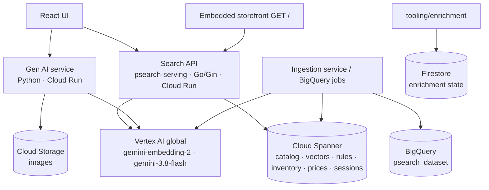

# PSearch: AI-Powered Enterprise Product Search Platform on Cloud Spanner & Vertex AI

## Overview

PSearch is an enterprise product search platform built on Google Cloud. It runs **hybrid retrieval natively in Cloud Spanner** — vector similarity and full-text search fused with Reciprocal Rank Fusion (RRF) in a single SQL statement — and uses **Gemini models on Vertex AI (`global`)** for query embeddings, conversational query understanding and content generation. On top of retrieval it layers merchandising rules, business-signal boosts, learning to rank, session personalization, delivery promises by postal code (CEP) and B2B contract pricing, all exposed through one `/api/search` endpoint.

> **Live hosted endpoints**
> - Search API and embedded storefront: Cloud Run service `psearch-serving` — open `<SERVICE_URL>/` for the storefront, `<SERVICE_URL>/api/info` for the running configuration.
> - Evaluation dashboard: Cloud Run service `psearch-eval-dashboard`.
> - Find the URLs with `gcloud run services describe psearch-serving --region us-central1 --format='value(status.url)'`. Real project IDs and URLs are intentionally not committed to this repository.

**Core features**

* **Spanner hybrid search** — vector + full-text legs fused with RRF, tunable with `alpha`, filters applied inside both legs.
* **1024-d semantic vectors** — `gemini-embedding-2` with Blue/Green `v1`/`v2` columns and a two-tier embedding cache.
* **Conversational queries** — "tênis de corrida até 200 reais" becomes a clean query plus price/brand filters; optional Gemini fallback.
* **Typo recovery** — "sansung" → "samsung", "geladera" → "geladeira", AND → OR relaxation when nothing matches.
* **Ranking controls** — merchandising rules (pin/bury/boost), 8 business signals, synonyms at reduced weight, two-stage learning to rank, session personalization.
* **Commerce context** — stock/visibility/channels, multi-tenant multi-language catalogs, delivery promises by CEP, B2B contract price tables.
* **Two front ends** — a React application and a zero-dependency storefront embedded in the serving binary.

## Project Status & Capabilities Matrix (Waves 1–6)

| Component | Status | Notes |
|---|---|---|
| Search API (`src/psearch/serving`) | ✅ Live | All functional requirements + SKU variant grouping |
| React UI (`src/application/ui`) | ✅ Complete | Search, facets, rules manager, session panel, B2B pricing, variants |
| Embedded storefront (`GET /`) | ✅ Live | Catalog browse, "Show All Catalog", all search controls |
| Spanner schema | ✅ Applied | Base schema + migrations 011–022 |
| Gen AI service (`src/psearch/gen_ai`) | ✅ Complete | Enrichment, marketing, images, conversational search, SQL agent |
| Ingestion (`src/psearch/ingestion_source`, BigQuery scripts) | ✅ Complete | Reverse ETL to Spanner, v2 embedding backfill |
| Query/click analytics in BigQuery | 🔄 Follow-up | Needed for analytics-driven autocomplete and trained LTR weights |

| Req. | Capability | Issue | Wave |
|---|---|---|---|
| 1 | Hybrid search with parametrized `alpha` (RRF) | #78 | 1 |
| 2 | Vector search: 1024-d, Blue/Green, embedding cache | #79 | 1 |
| 3 | Availability, visibility, channels; out-of-stock last | #80 | 1 |
| 4 | Multi-language, multi-tenant catalog; accent folding | #81 | 2 |
| 5 | Server-side concurrent facets | #82 | 2 |
| 6 | Merchandising rules + 8 boost signals | #83 | 3 |
| 7 | Low-relevance synonyms | #84 | 3 |
| 8 | Delivery promises by CEP (interleaved inventory) | #85 | 3 |
| 9 | N-gram autocomplete | #86 | 4 |
| 10 | Two-stage learning to rank | #87 | 4 |
| 11 | Conversational query understanding | #88 | 5 |
| 12 | Session-aware personalization | #89 | 5 |
| 13 | Zero-results recovery & spell check | #90 | 5 |
| 14 | B2B contract pricing & assortment | #91 | 5 |
| 15 | Variant grouping / collapse over interleaved SKUs | #93 | 6 |
| Platform | `gemini-embedding-2` 1024-d via the Gen AI SDK | #77 | — |
| Platform | `gemini-3.8-flash` (text) & `gemini-4-argon` (pro) | #92 | — |

Further reading: [PRODUCT.md](PRODUCT.md) (requirements) · [DESIGN.md](DESIGN.md) (architecture, full API reference) · [DEPLOYMENT.md](DEPLOYMENT.md) (deployment guide and release log).

## Architecture



### Core Services

* **Search API (Go/Gin, `src/psearch/serving/`)** — validates requests, decomposes conversational queries, runs the hybrid Spanner statement, recovers zero-result queries, aggregates facets, attaches delivery promises, re-ranks (LTR, session) and serves the embedded storefront. Entrypoints: `cmd/server` (API), `cmd/sqlcheck` (pre-deploy SQL gate), `cmd/backfill-embeddings` (v2 vectors).
* **React UI (`src/application/ui/`)** — search with all controls, server facets, rules manager (`/manage`), session panel, product details with Gen AI enrichment, source ingestion.
* **Gen AI service (Python/FastAPI, `src/psearch/gen_ai/`)** — content enrichment, marketing copy, image generation, conversational search, SQL generation/fix agent (`google-genai`, `gemini-3.8-flash` / `gemini-4-argon` / `gemini-3.1-flash-image`).
* **Ingestion (`src/psearch/ingestion_source/`, `src/iac/bigquery_scripts/`)** — loads catalog data and embeddings from BigQuery into Spanner.

### Datastores

* **Cloud Spanner (`psearch-instance` / `psearch-db`)** — system of record:
  * `products` with full-text tokenlists (plus accent-folded variants), 768-d `embedding` (v1) and 1024-d `embedding_v2` (v2), availability, visibility, channels, tenant/locale and 8 business signals.
  * Interleaved hierarchies: `products` → `skus` → `regional_inventory` (delivery promises) and `products` → `product_prices` (B2B pricing).
  * `merchandising_rules`, `search_synonyms`, `autocomplete_suggestions` (n-gram index), `embedding_cache`, `query_intent_cache`, `user_session_events`.
* **BigQuery (`psearch_dataset`)** — ingestion source and analytics (autocomplete export, LTR training scripts).
* **Firestore** — enrichment job state used by `tooling/enrichment`.
* **Cloud Storage** — generated and enhanced product images.

## Technology Stack

* **Frontend:** React 19, Material UI, Axios; embedded HTML/JS storefront.
* **Backend:** Go 1.26 with Gin (Search API); Python with FastAPI (Gen AI service, ingestion).
* **Databases:** Cloud Spanner (GoogleSQL, full-text `SEARCH`/`SCORE`, `SEARCH_NGRAMS`, vector `COSINE_DISTANCE`, interleaved tables); BigQuery; Firestore.
* **AI/ML (Vertex AI, location `global`, Google Gen AI SDK):** `gemini-embedding-2` (1024-d embeddings), `gemini-3.8-flash` (text/flash, intent fallback), `gemini-4-argon` (pro reasoning), `gemini-3.1-flash-image` (images); in-process Go LTR model; BigQuery ML for LTR training.
* **Infrastructure:** Cloud Run, Cloud Build, Artifact Registry, Terraform (`src/iac`), Docker.

## Repository Structure

```
├── README.md                          # This file
├── PRODUCT.md                         # Product requirements (Waves 1–6)
├── DESIGN.md                          # Architecture, SQL design, scoring, API reference, configuration
├── DEPLOYMENT.md                      # Deployment guide, migrations, release log
├── Dockerfile                         # Search API container (multi-stage Go build)
├── LICENSE                            # Apache 2.0
├── docs/
│   └── USAGE.md, contributing.md      # Usage and contribution guides
├── src/
│   ├── application/ui/                # React UI (src/components, src/services)
│   ├── iac/
│   │   ├── main.tf, variables.tf      # Terraform root
│   │   ├── modules/                   # iam, spanner, ingestion_spanner, search_api, ui, gen_ai, ingestion_source
│   │   ├── migrations/                # Spanner migrations 011–022 (DDL + seed DML)
│   │   └── bigquery_scripts/          # Embedding model, Spanner export, autocomplete export, LTR training
│   └── psearch/
│       ├── serving/                   # Go Search API
│       │   ├── cmd/                   # server, sqlcheck, backfill-embeddings
│       │   └── internal/              # api (routes, handlers, storefront), config, models, services
│       ├── gen_ai/                    # Python Gen AI service
│       └── ingestion_source/          # Source ingestion service
└── tooling/
    ├── enrichment/                    # Batch image/description enrichment
    └── loadtest/                      # Load-test tooling
```

## Hybrid Search & Multi-Stage Ranking Implementation

PSearch runs retrieval, fusion and most ranking in **one Spanner statement**, then refines in Go. Full details and formulas: [DESIGN.md](DESIGN.md).

1. **Vector similarity** — the query embedding (`gemini-embedding-2`, `RETRIEVAL_QUERY`, 1024-d, cached) is compared with `COSINE_DISTANCE` against `embedding_v2` (or the 768-d `embedding` in `v1`). Exact KNN is used at the current catalog size; a ScaNN index with `APPROX_COSINE_DISTANCE` is a scaling follow-up.
2. **Full-text search** — `SEARCH()` / `SCORE()` over title and description tokenlists (accent-folded with `TEXT_FOLDING=true`), with synonym expansion at reduced weight and exact matches ordered first.
3. **Reciprocal Rank Fusion** — `rrf = α · 1/(60 + rank_vector) + (1 − α) · 1/(60 + rank_text)`; `final_score = rrf · rule_multiplier + boost`, with pins first, buries last and unavailable products always last.
4. **Conversational query understanding** — a deterministic parser extracts price ranges, brands and categories (pt-BR/en/es) before retrieval; Gemini (`gemini-3.8-flash`) is an optional fallback with a two-tier cache.
5. **Two-stage learning to rank** — Spanner returns the top 100 candidates; an in-memory Go model scores 12 normalized features (rrf, vector, text, 8 business signals, delivery SLA) in microseconds (`ltr=true`).
6. **Session centroid personalization** — the weighted, recency-decayed mean of the session's product vectors boosts similar products: `session_boost = w · max(0, cos(centroid, product))`.
7. **Zero-results recovery** — when the text leg finds nothing, an n-gram spell checker (`SEARCH_NGRAMS` over the autocomplete index plus catalog vocabulary) suggests and applies corrections; otherwise the query is relaxed from AND to OR.
8. **Interleaved B2B pricing & regional CEP SLA** — split-local lookups into `product_prices` resolve the buyer's effective price for results, filters, facets and price sorting; `regional_inventory` restricts results to products deliverable to the buyer's CEP within the requested SLA and attaches the fastest promise.
9. **Catalog browse** — an empty or `*` query lists the catalog (with all filters) instead of running retrieval; the storefront uses it on load and for "Show All Catalog".

## Product Evaluation Methodology (5-Layer Pyramid)

Search quality is governed by a 5-layer evaluation pyramid of **76 scenarios**; **100 % must pass** before a release is declared production-ready.

| Layer | Focus | Scenarios |
|---|---|---|
| L1 | Trajectory & state sequence | 12 |
| L2 | Policy & business guardrails | 15 |
| L3 | Adversarial & red-team robustness | 16 |
| L4 | Multi-mode routing & engine parity | 28 |
| L5 | Live Vertex AI & factory telemetry | 5 |

Every rollout additionally passes `go vet`, `go test -race`, the UI build, an independent review, and `cmd/sqlcheck` against the real database.

## Setup and Deployment

### Prerequisites

* Google Cloud SDK (`gcloud`) installed and authenticated.
* Terraform, Docker, Go 1.26+, Python 3.11+, Node.js 20+ with npm.
* A Google Cloud project with billing and the Spanner, Cloud Run, Cloud Build, Artifact Registry, Vertex AI, BigQuery and IAM APIs enabled.

### Clone Repository

```bash
git clone https://github.com/GoogleCloudPlatform/psearch.git
cd psearch
```

### Configure Infrastructure

1. Go to the Terraform root: `cd src/iac`.
2. Provide the Terraform variables — at least `project_id`, `project_number` and `region` — via a `terraform.tfvars` file or `-var` flags (see `src/iac/variables.tf`).
3. The Spanner module (`src/iac/modules/spanner`) defines the base schema; the instance requires **at least 1000 processing units** (enforced by a validation rule).

### Provision Infrastructure

```bash
terraform init
terraform apply
```

Then apply the numbered schema migrations in order (`src/iac/migrations/011` … `021`) as described in [DEPLOYMENT.md §3](DEPLOYMENT.md#3-spanner-schema-migrations).

### Deploy Application Services

Each service has a Cloud Build pipeline: `src/psearch/serving/cloudbuild.yaml`, `src/psearch/gen_ai/cloudbuild.yaml`, `src/psearch/ingestion_source/cloudbuild.yaml`, `src/application/ui/cloudbuild.yaml`. The Search API runs as a dedicated runtime service account with `roles/aiplatform.user` and `roles/spanner.databaseUser`. Production settings (`ACTIVE_EMBEDDING_VERSION=v2`, `GENAI_LOCATION=global`, `TEXT_FOLDING=true`, …) and the release procedure (clean `git archive`, `cmd/sqlcheck`, `update-traffic --to-latest`) are documented in [DEPLOYMENT.md](DEPLOYMENT.md).

### Local Development

1. **Search API (no GCP required):**
   ```bash
   cd src/psearch/serving
   USE_MEMORY_STORE=true go run ./cmd/server     # http://localhost:8080 (storefront at /)
   go vet ./... && go test -race ./...
   ```
2. **React UI:**
   ```bash
   cd src/application/ui
   npm install --legacy-peer-deps
   REACT_APP_API_URL=http://localhost:8080 npm start   # http://localhost:3000
   ```
3. **Gen AI service:**
   ```bash
   cd src/psearch/gen_ai
   python -m pip install -r requirements.txt
   python main.py
   ```

Against real Spanner and Vertex AI, set `PROJECT_ID`, `SPANNER_INSTANCE_ID`, `SPANNER_DATABASE_ID`, `ACTIVE_EMBEDDING_VERSION=v2`, `GENAI_LOCATION=global` and Application Default Credentials. All variables: [DESIGN.md §16](DESIGN.md#16-configuration-environment).

### Google Cloud Costs

Estimated with the [Google Cloud pricing calculator](https://cloud.google.com/products/calculator) for **500k SKUs** and **70k queries/day**:

| Service | GCP Product | Cost (monthly) |
|---|---|---|
| Catalog | Cloud Spanner | $987.90 |
| Search API | Cloud Run | $115.63 |
| UI | Cloud Run | $115.63 |
| Gen AI API | Cloud Run | $115.63 |
| Embeddings — Search API | Vertex AI | $10.65 |
| Embeddings — Ingestion | Vertex AI | $121.67 |
| **Total** | — | **$1,491.06** |

⚠️ **Disclaimer:** this estimate excludes Gemini text/pro model usage (query understanding fallback, Gen AI service) and BigQuery; calculate those for your own volume.

## Data Ingestion

1. **BigQuery → Spanner (reverse ETL):** `src/iac/bigquery_scripts/create_embedding_model.sql` registers the `gemini-embedding-2` remote model; `transform_embed_export_to_spanner.sql` transforms products, generates 1024-d `RETRIEVAL_DOCUMENT` embeddings with `ML.GENERATE_EMBEDDING` and exports them to Spanner (`embedding_v2`).
2. **v2 embedding backfill:** for rows already in Spanner, run
   ```bash
   cd src/psearch/serving
   PROJECT_ID=<PROJECT_ID> GENAI_LOCATION=global EMBEDDING_MODEL_NAME=gemini-embedding-2 \
     EMBEDDING_DIMENSION=1024 go run ./cmd/backfill-embeddings -dry-run   # then without -dry-run
   ```
3. **Analytics exports:** `autocomplete_export_to_spanner.sql` (top queries → `autocomplete_suggestions`) and `ltr_train.sql` (BigQuery ML LTR weights → `LTR_MODEL_JSON`) run once query/click logs exist in `psearch_dataset`.

## API Usage

```bash
BASE=<SERVICE_URL>   # or http://localhost:8080
```

**Search** (`GET` or `POST /api/search`; every parameter is documented in [DESIGN.md §15](DESIGN.md#15-api-reference)):

```bash
# Hybrid search, tuned toward semantics
curl "$BASE/api/search?q=running+shoes&alpha=0.7&limit=10"

# Conversational query (parsing is on by default): clean_query "tenis de corrida", max_price 200
curl "$BASE/api/search?q=tenis+de+corrida+ate+200+reais"

# B2B contract prices, cheapest first
curl "$BASE/api/search?q=laptop&price_table_id=b2b-corporate&sort_by=price_asc"

# Delivery promise for a CEP, next-day only
curl "$BASE/api/search?q=shoes&cep=01310-100&max_sla_hours=24"

# Two-stage LTR + session personalization
curl "$BASE/api/search?q=shoes&ltr=true&session_id=sess-demo-0001"

# Full catalog browse
curl "$BASE/api/search?q=*&limit=100"

# POST form
curl -X POST "$BASE/api/search" -H 'Content-Type: application/json' \
     -d '{"query":"geladeira","locale":"pt-BR","tenant_id":"default","only_in_stock":true}'
```

**Sessions, autocomplete, rules, synonyms, system:**

```bash
curl -X POST "$BASE/api/session/events" -H 'Content-Type: application/json' \
     -d '{"session_id":"sess-demo-0001","product_id":"prod-003","event_type":"purchase"}'
curl "$BASE/api/session/events?session_id=sess-demo-0001"
curl "$BASE/api/autocomplete?q=gel&locale=pt-BR&limit=8"
curl "$BASE/api/rules?tenant_id=default"
curl -X POST "$BASE/api/rules" -H "X-Admin-Token: $ADMIN_TOKEN" -H 'Content-Type: application/json' \
     -d '{"name":"Pin Pegasus","query_pattern":"shoes","pin_product_ids":["prod-003"],"active":true}'
curl "$BASE/api/synonyms?locale=pt-BR"
curl "$BASE/api/config/embedding-version"
curl "$BASE/api/info"
curl "$BASE/health"
```

Admin writes (`POST/PUT/DELETE /api/rules`, `POST /api/synonyms`, `POST /api/config/embedding-version`) require `X-Admin-Token` equal to `ADMIN_TOKEN` and are disabled when it is unset.

**Gen AI service** (`src/psearch/gen_ai/main.py`, base URL `$GENAI_URL`):

```bash
curl "$GENAI_URL/health"
curl -X POST "$GENAI_URL/conversational-search" -H 'Content-Type: application/json' -d '{"query":"presente para corredor"}'
curl -X POST "$GENAI_URL/enrichment" -H 'Content-Type: application/json' \
     -d '{"product_id":"prod-001","product_data":{"title":"UltraBoost Pro Running Shoes"},"fields_to_enrich":["description"]}'
curl -X POST "$GENAI_URL/marketing" -H 'Content-Type: application/json' \
     -d '{"product_id":"prod-001","product_data":{"title":"UltraBoost Pro Running Shoes"},"content_type":"social_post","tone":"energetic"}'
curl -X POST "$GENAI_URL/generate-enhanced-image" -H 'Content-Type: application/json' \
     -d '{"product_id":"prod-001","product_data":{},"image_base64":"<BASE64>","background_prompt":"city running track at sunrise"}'
```

Request models (`ConversationalSearchRequest`, `EnrichmentRequest`, `MarketingRequest`, `EnhancedImageRequest`, SQL agent models) are defined in `src/psearch/gen_ai/main.py`.

## Troubleshooting

### Common Issues

1. **Spanner permissions** — the runtime service account needs `roles/spanner.databaseUser` on `psearch-db`; `PermissionDenied` on client metrics export can be silenced with `SPANNER_DISABLE_BUILTIN_METRICS=true`.
2. **Vector search capacity** — the Spanner instance must have at least 1000 processing units (Terraform validation).
3. **Embedding generation** — `retrieval_mode=lexical_only_degraded` means the query embedding failed; check that the runtime service account has `roles/aiplatform.user`, that `EMBEDDING_DIMENSION` matches the column (1024 for v2), and that `embedding_v2` is backfilled.
4. **Vertex AI `global` endpoint** — Gemini 3.x/4 and `gemini-embedding-2` are served from `global` (or the `us`/`eu` multi-regions), not from `us-central1`; keep `GENAI_LOCATION=global` independent of the Cloud Run region.
5. **`memory_fallback` in responses** — the Spanner query failed (or no client is configured); run `go run ./cmd/sqlcheck` with the production environment to see the SQL error.
6. **API connectivity from the UI** — set `REACT_APP_API_URL` (the dev proxy in `src/application/ui/src/setupProxy.js` forwards `/search`); for the storefront, open `GET /` on the Search API directly.
7. **Storefront stuck on "Loading catalog..."** — the inline storefront script failed to parse; `go test ./internal/api` runs `node --check` on it (`TestStorefrontInlineJSParses`).

## Contributing

See [docs/contributing.md](docs/contributing.md). Changes to the Search API must keep Spanner/memory parity, use bound SQL parameters, add a `cmd/sqlcheck` case for new SQL, and pass `go vet`, `go test -race` and `npm run build`.

## License

This project is licensed under the Apache License 2.0 — see [LICENSE](LICENSE).

## Disclaimer

This is not an officially supported Google product. This project is not eligible for the [Google Open Source Software Vulnerability Rewards Program](https://bughunters.google.com/open-source-security).
